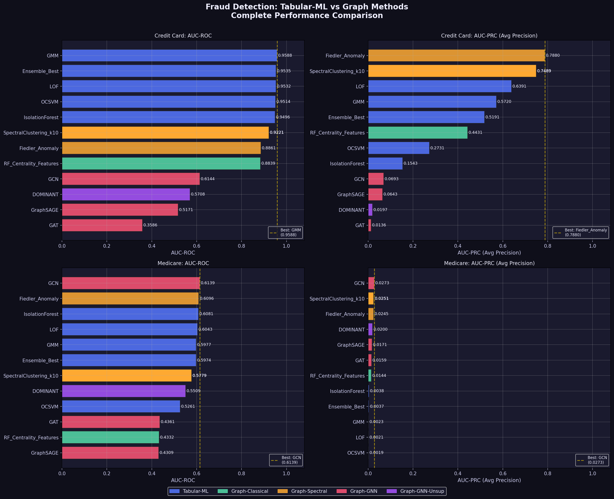
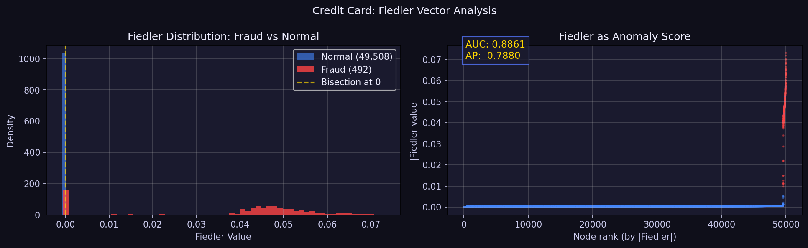
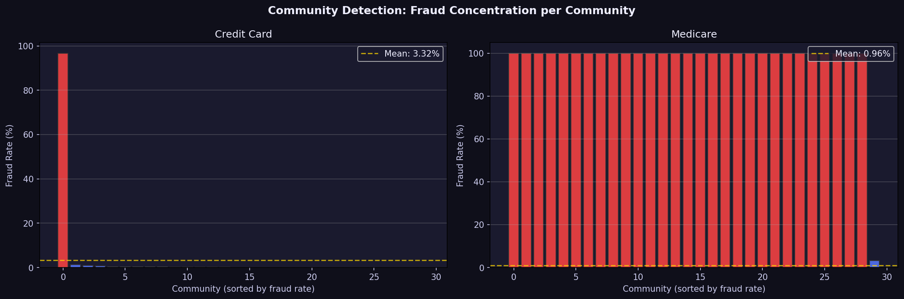
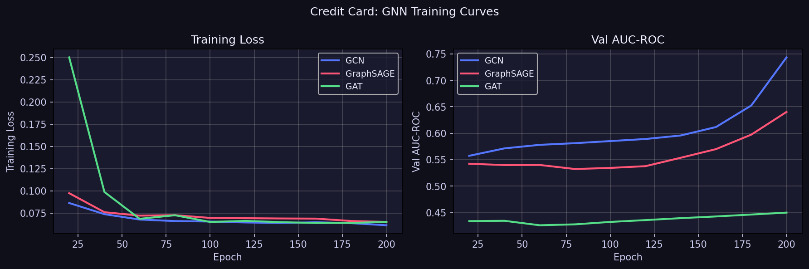

# Fraud Detection via Graph Theory

Graduate graph theory term project. It tests whether graph methods (centrality features, community detection, spectral methods, GNNs) detect fraud better than tabular one-class anomaly detection, on a credit card transaction dataset and a Medicare provider dataset.

Outcome: the hypothesis that graph methods outperform the tabular baseline was not supported on credit card data and only marginally supported on Medicare. On credit card, the best graph method (spectral clustering, AUC-ROC 0.9221) stayed below the tabular baseline (GMM, 0.9588), a gap of 0.0367. On Medicare, the best graph method (GCN, 0.6139) exceeded the baseline (Isolation Forest, 0.6081) by 0.0058, which is within what a single-seed run can produce. GNNs were the weakest family on credit card; spectral methods were the strongest graph family there and gave the highest AUC-PRC of any method (Fiedler score, 0.7880).

## Results

Test metrics per method. Graph rows come from `outputs/metrics/*.json`; tabular rows are carried over from a companion tabular project and are listed in `reports/comparison_ml_vs_graph.md`.

| Family | Method | Credit Card AUC-ROC | Credit Card AUC-PRC | Medicare AUC-ROC | Medicare AUC-PRC |
|:--|:--|--:|--:|--:|--:|
| Tabular one-class | GMM | 0.9588 | 0.5720 | 0.5977 | 0.0023 |
| Tabular one-class | LOF | 0.9532 | 0.6391 | 0.6043 | 0.0021 |
| Tabular one-class | OCSVM | 0.9514 | 0.2731 | 0.5261 | 0.0019 |
| Tabular one-class | Isolation Forest | 0.9496 | 0.1543 | 0.6081 | 0.0038 |
| Tabular one-class | Best ensemble | 0.9535 | 0.5191 | 0.5974 | 0.0037 |
| Classical graph | Random Forest on centrality features | 0.8839 | 0.4431 | 0.4332 | 0.0144 |
| Spectral | Fiedler vector anomaly score | 0.8861 | 0.7880 | 0.6096 | 0.0245 |
| Spectral | Spectral clustering, k=10 | 0.9221 | 0.7489 | 0.5779 | 0.0251 |
| GNN (supervised) | GCN | 0.6144 | 0.0693 | 0.6139 | 0.0273 |
| GNN (supervised) | GraphSAGE | 0.5171 | 0.0643 | 0.4309 | 0.0171 |
| GNN (supervised) | GAT | 0.3586 | 0.0136 | 0.4361 | 0.0159 |
| GNN (unsupervised) | DOMINANT | 0.5708 | 0.0197 | 0.5509 | 0.0200 |

F1 and training time were recorded only for the GNNs (`outputs/metrics/gnn_results.json`):

| Method | Credit Card F1 | Credit Card train time (s) | Medicare F1 | Medicare train time (s) |
|:--|--:|--:|--:|--:|
| GCN | 0.120 | 35.2 | 0.057 | 9.7 |
| GraphSAGE | 0.096 | 28.4 | 0.037 | 7.7 |
| GAT | 0.020 | 51.8 | 0.037 | 16.5 |
| DOMINANT | n/a | 1263.7 | n/a | 37.4 |



*All methods ranked by AUC-ROC (left) and AUC-PRC (right), credit card on top, Medicare below. Colors mark the method family.*



*Credit card graph: most fraud nodes take Fiedler vector values between about 0.04 and 0.07 while normal nodes sit near zero. Using |Fiedler value| as an unsupervised score gives AUC-ROC 0.8861 and AUC-PRC 0.7880.*



*Fraud rate of the 30 Louvain communities with the highest fraud rate. Credit card: one community of 396 nodes contains 383 fraud transactions (96.7%). Medicare: the 100% bars are single-provider communities (3,042 communities over 7,701 nodes), so they carry no structural information.*



*Credit card GNN training: validation AUC-ROC for GCN and GraphSAGE is still rising at epoch 200, where training stopped.*

### How to read these numbers

- The comparison is not like-for-like in supervision. The tabular baselines are one-class models, the Fiedler score and DOMINANT are unsupervised, and the Random Forest and GCN/GraphSAGE/GAT are trained on labels.
- The spectral clustering score assigns each node the fraud rate of its cluster, computed from the labels of the same nodes it is evaluated on. Its AUC values are in-sample and optimistic.
- The Random Forest is scored with 5-fold cross-validated predictions. GNNs use a stratified 70/10/20 split, one run, seed 42, on CPU. The GNN F1 is the best F1 over a threshold sweep on the test split.
- The credit card graph keeps all 492 fraud transactions and subsamples normal ones to 50,000 nodes, so the fraud rate in the graph is 0.98% against 0.173% in the full dataset. The tabular baseline numbers were not re-run on this subset.
- GNN input features are the seven centrality features per node, not the original transaction or prescribing attributes.
- Medicare AUC-PRC is below 0.03 for every method. With 137 fraud providers out of 7,701 (1.78%), none of the methods is usable as a detector on this data.

## Method

### Graph construction

| | Credit Card | Medicare |
|:--|:--|:--|
| Source | ULB credit card fraud dataset, 284,807 transactions, 492 fraud | CMS Medicare Part D prescriber files 2017-2019, labels from the OIG LEIE exclusion list |
| Node | Transaction | Provider (NPI) |
| Edge | k-nearest neighbors (k=10) under cosine similarity in PCA-reduced feature space | Two providers share at least 5 prescribed drugs, after projecting the provider-drug bipartite graph |
| Size | 50,000 nodes, 347,127 edges | 7,701 nodes, 113,350 edges |
| Fraud nodes | 492 | 137 |

The Medicare projection needed three restrictions to stay tractable: 2,000,000 rows read per yearly file, drugs prescribed by more than 25% of providers removed as hubs (and those below 0.5% as too rare), and each provider limited to its 25 strongest edges. Without hub removal the projection approached a complete graph.

### Method families

- **Classical graph analysis.** Degree, PageRank, betweenness, closeness, eigenvector centrality and local clustering coefficient per node, used as features for a class-weighted Random Forest. Louvain community detection and triangle/hub counts are used descriptively.
- **Spectral methods.** Eigendecomposition of the normalized Laplacian. The Fiedler vector magnitude is used as an anomaly score (Fiedler value 0.000619 on credit card, 0.013493 on Medicare). Spectral clustering runs k-means with k=10 on the bottom eigenvectors. A Chebyshev polynomial approximation is included to show the link from spectral filtering to GCN.
- **Graph neural networks** (PyTorch Geometric). GCN, GraphSAGE and GAT trained with class-weighted binary cross-entropy for 200 epochs; DOMINANT, an unsupervised autoencoder that scores nodes by structure and attribute reconstruction error, trained for 100 epochs.

Hyperparameters are in `config.yaml`. Derivations and references are in `reports/methodology.md`.

## Repository layout

```
Fraud-Detection-GT/
├── notebooks/            # 01 EDA and baseline, 02 graph construction, 03 classical analysis,
│                         # 04 spectral methods, 05 GNN models, 06 comparison (with saved outputs)
├── scripts/              # nb_0X_*.py notebook sources, generate_notebooks.py, colab_setup.py
├── src/
│   ├── graph_builder.py  # k-NN and bipartite projection graph construction
│   ├── graph_features.py # centrality, community, spectral features
│   ├── gnn_models.py     # GCN, GraphSAGE, GAT, DOMINANT, trainer, data splits
│   ├── baseline_loader.py# loads tabular baseline results
│   ├── evaluation.py     # metrics and comparison table
│   └── visualization.py
├── outputs/
│   ├── figures/          # 20 PNG figures
│   └── metrics/          # classical_graph_results.json, spectral_results.json,
│                         # gnn_results.json, dataset_stats.json
├── reports/
│   ├── methodology.md
│   └── comparison_ml_vs_graph.md
├── final.md              # full written report (Markdown)
├── report.pdf            # full written report (PDF)
├── presentation.pptx     # final presentation
├── colab_setup.md        # Google Drive / Colab setup notes (in Turkish)
├── config.yaml
└── requirements.txt
```

Datasets, saved graphs and model weights are not in the repository.

## Quick start

The notebooks were run on Google Colab with data on Google Drive; each notebook starts with a setup cell that mounts Drive and sets paths. `colab_setup.md` describes the expected Drive layout.

1. Install dependencies:
   ```bash
   pip install -r requirements.txt
   ```
   `torch-geometric` may need extra wheels depending on the CUDA version; see the comment in `requirements.txt`.

2. Get the data:
   - Credit card: `creditcard.csv` from [Kaggle](https://www.kaggle.com/datasets/mlg-ulb/creditcardfraud)
   - Medicare Part D Prescribers by Provider and Drug, 2017-2019, from [CMS](https://data.cms.gov/)
   - LEIE exclusion list from [OIG](https://oig.hhs.gov/exclusions/exclusions_list.asp)

3. Regenerate the notebooks from their sources if needed:
   ```bash
   python scripts/generate_notebooks.py
   ```

4. Run the notebooks in order, 01 to 06. Notebook 03 writes the centrality features that 05 reads, and 06 reads the JSON files written by 03, 04 and 05.

The tabular baseline is loaded from pickled results of a separate project that is not part of this repository. Without those files the baseline rows cannot be regenerated; the values used here are recorded in `reports/comparison_ml_vs_graph.md`.

## Report

- `report.pdf`: full report with background, method, results and discussion. `final.md` is the same report in Markdown.
- `reports/comparison_ml_vs_graph.md`: the generated comparison table.
- `reports/methodology.md`: formulation, graph construction and evaluation protocol.

## Author

Baha Kırbaşoğlu, MSc, Istanbul Technical University.

## License

MIT
